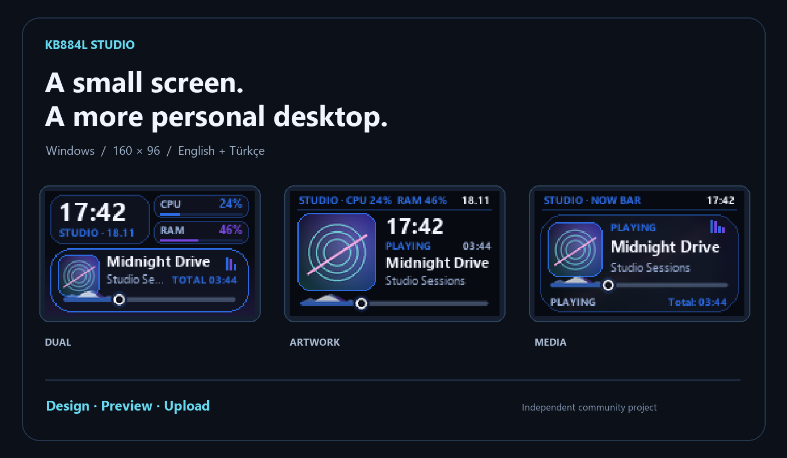
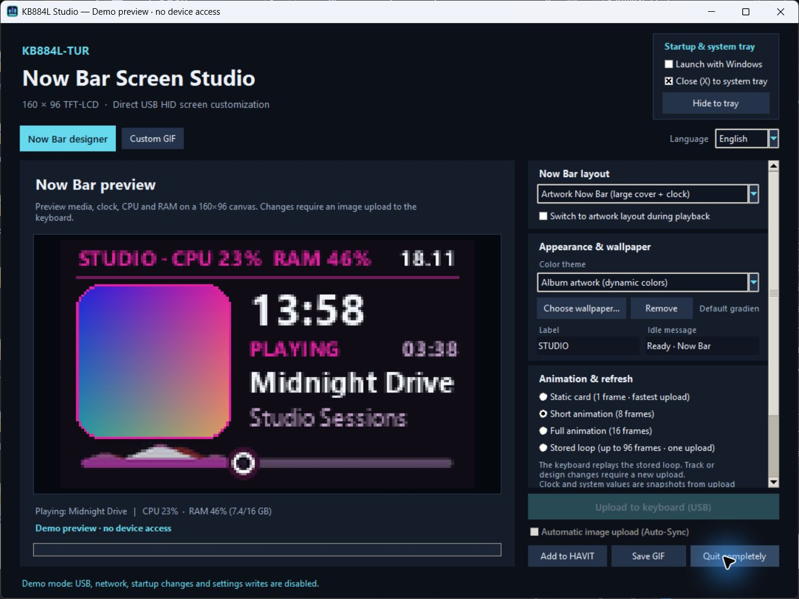
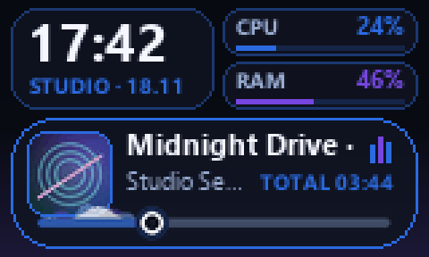
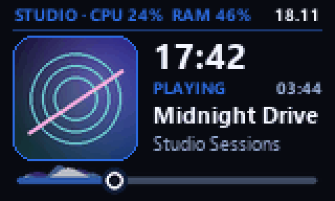
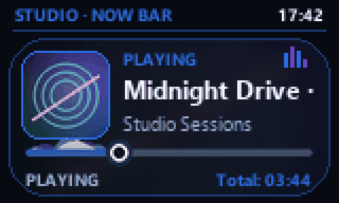
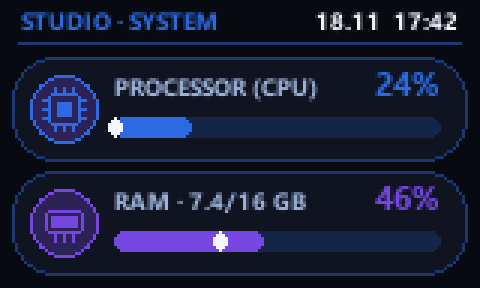

<p align="center">
  
</p>

<h1 align="center">KB884L Studio</h1>
<p align="center"><strong>A small screen. A more personal desktop.</strong><br>
A Windows screen designer and direct USB companion for the HAVIT KB884L-TUR.</p>

<p align="center">
  <a href="https://github.com/xCenny/kb884l-studio/releases/tag/v0.1.0"></a>
  <a href="https://github.com/xCenny/kb884l-studio/actions/workflows/windows.yml"></a>
  <a href="LICENSE"></a>
  
</p>

<p align="center"><a href="README.tr.md">Türkçe</a> · <a href="#screens-and-layouts">Screen gallery</a> · <a href="#get-started">Get started</a> · <a href="#current-limits">Current limits</a> · <a href="docs/PROTOCOL.md">USB notes</a></p>

Design your keyboard display with floating music cards, album colors, a clock and system snapshots. Import a GIF in one step, preview it, and upload it directly—without opening the vendor application for each transfer.

> **Read this first:** Studio currently uploads complete images or animations. Uploads can interrupt the keyboard display with its **Loading** screen. This is **not custom firmware or a loading-free live dashboard**. Native text, partial framebuffer updates and firmware replacement remain unresolved research.

## See it in action



*The application in demo mode. Gallery images use synthetic artwork and sample metadata; they are rendered previews, not photos of physical hardware.*

<p align="center"></p>

## What you can do

| Feature | What it does |
|---|---|
| **Five display layouts** | Dual, Artwork, Media, System and Carousel cards at the panel's native 160×96 resolution. |
| **Windows now playing** | Reads Spotify or another compatible Windows media session. No Spotify API key or account connection is required. |
| **Album-inspired colors** | Builds a palette from artwork, with six themes and a custom wallpaper option for the Dual layout. |
| **GIF import** | Composites frames, fits or crops the image, adapts timing and samples long GIFs across their timeline. Up to 255 upload frames. |
| **Animation preview** | Scrolling titles, animated wallpaper, decorative playback motion and sliding layout transitions. |
| **CPU/RAM snapshots** | Includes processor use and memory use in the prepared screen. |
| **Direct USB upload** | Sends a complete screen animation over the reverse-engineered HID protocol. Serializes transfers and retries connection failures. |
| **English / Türkçe** | Switches application controls, dialogs, tray messages and built-in display labels. Your song titles and custom text stay untouched. |
| **Tray and startup** | Optional tray operation and Windows startup. Automatic upload and startup are off on a clean first launch. |
| **Vendor library export** | Adds prepared frames to the existing HAVIT library with a database backup. Also exports an ordinary GIF. |

## Screens and layouts

Every preview below is an animated GIF from the actual renderer. Watch the title scroll, playback motion and the Carousel's music/system transition. Sample system values are fixed snapshots.

| Dual | Artwork |
|:---:|:---:|
|  |  |
| Wallpaper, clock, system pills and music card. | Large cover, compact metadata and a status card. |

| Media | System |
|:---:|:---:|
|  |  |
| A focused now-playing capsule. | CPU and RAM cards. |

<p align="center"><br><em>Carousel alternates between music and system cards in animated modes.</em></p>

## Get started

### Download the Windows app

1. Get the **Windows x64 ZIP** from [Releases](https://github.com/xCenny/kb884l-studio/releases/tag/v0.1.0).
2. Extract it into a writable folder and open `KB884L-Studio.exe`. No Python installation is needed.
3. Connect the supported keyboard by USB. Close the official HAVIT application completely before uploading.
4. Select English or Türkçe, a layout and theme. Use **Upload to keyboard (USB)** when ready.

On a clean launch, automatic uploads and startup are disabled. Enable them only when you want the corresponding behavior. The first public build is unsigned.

### Run from source

Windows 10/11 x64 and Python **3.14** are the tested build environment. Other Python versions are not verified.

```powershell
git clone https://github.com/xCenny/kb884l-studio.git
cd kb884l-studio
py -3.14 -m venv .venv
.\.venv\Scripts\python.exe -m pip install -r requirements.txt
.\.venv\Scripts\python.exe studio.py
```

Preview the UI without reading media, accessing USB, saving preferences or changing startup:

```powershell
.\.venv\Scripts\python.exe studio.py --demo
```

## Choose a transfer mode

| Mode | Intended use | Tradeoff |
|---|---|---|
| **Static** | A single music/system card. | Least data per update; still uses the upload path. |
| **Fast animation** | An eight-frame animated card. | Short loop, smaller transfer. |
| **Full animation** | A sixteen-frame loop or carousel. | More motion and more data. |
| **Device loop** | A prepared animation replayed by the keyboard. | Usually up to 96 frames; does not refresh for clock/CPU changes. Snapshot values can become stale. |

New track or design information still requires a new transfer. A 31-frame test took about **32 seconds** on the tested unit. A static screen is smaller, but neither option guarantees uninterrupted updates. Playing fewer frames is not a solution to live data transport.

Playback indicators are **decorative animations**, not an audio spectrum analyzer. Prepared progress graphics are not a promise of exact live playback position.

## Compatibility

Verified on one **HAVIT KB884L-TUR** unit:

| Identity | Verified value |
|---|---|
| USB VID:PID | `05AC:024F` |
| USB release descriptor | `0x0111` — not a verified firmware version |
| Manufacturer / product | `SONiX` / `Gaming Keyboard` |
| Display | 160×96, RGB565 |
| Control / pixel interfaces | `FF13` / `FF68`, matching report descriptors |

The program checks more than the VID/PID. Other keyboards reuse these IDs. **KB884L Pro, HE, other revisions and unrelated SONiX models are not verified or supported.** Linux and macOS are not supported by this Windows application.

## Current limits

- **Loading-free updates are not implemented.** The device's upload screen and transfer duration remain the main limitation.
- **The keyboard firmware is unchanged.** No target firmware image, exact MCU/pin mapping or recovery procedure has been verified.
- **Notifications are not integrated.** Legacy drawing helpers do not constitute a working notification listener.
- CPU, RAM, clock and media visuals are prepared on the PC. An autonomous loop contains snapshots; it does not keep querying the PC.
- Independent stored display pages have not been verified. The application does not promise instant page switching.
- GIF adaptation can change timing. Device-loop wallpapers longer than 48 seconds are compressed into its timing budget; the dedicated GIF tool has a separate 255-frame limit.

See [architecture and research boundaries](docs/ARCHITECTURE.md). Firmware work belongs in a separate, target-verified effort; this release contains no firmware flasher.

## Privacy and local files

Preferences are saved next to the app in `studio_settings.json`; keep the folder writable. No personal settings, wallpaper, media history or vendor database is shipped in this repository.

Media metadata is read from Windows SMTC. If the session does not provide album art, the current implementation may query **Apple's iTunes Search API with the track title and artist**, then download the matching artwork. It does not use Spotify's Web API. There is no application analytics or account login. Startup uses the current user's Windows Run registry entry only when enabled.

Local single-instance commands use UDP on `127.0.0.1:48884`; complete screen transactions also use a Windows named mutex. Vendor library export modifies the selected local HAVIT database after making a backup.

## Build and test

```powershell
.\.venv\Scripts\python.exe -m pip install -r requirements-build.txt
.\.venv\Scripts\python.exe -m unittest discover -s tests -p "test_*.py"
.\.venv\Scripts\python.exe scripts/build.py
```

The build script runs the tests, builds the portable executable, runs its rendering self-test, and creates a release ZIP with license notices and SHA-256 checksums in `dist/`. Tests use fake USB and media objects; they do not upload to a keyboard. Windows CI performs the same build.

## Contribute

Bug reports, translation fixes and carefully documented protocol research are welcome. Include the exact model, USB release/descriptor information and a reproducible description. Remove personal file paths and track metadata from logs first. See [CONTRIBUTING.md](CONTRIBUTING.md).

Useful next steps are a verified native LCD data path, opt-in artwork lookup controls, real notification integration and broader hardware evidence. A star helps others find the project; contributions help it improve.

## License and credits

[MIT](LICENSE). Dependency licenses and distribution notes are in [THIRD_PARTY_NOTICES.md](THIRD_PARTY_NOTICES.md). This is an independent community project and is not affiliated with HAVIT, SONiX, Spotify or Apple. No vendor executable, firmware, font or third-party album artwork is included in the source tree.
