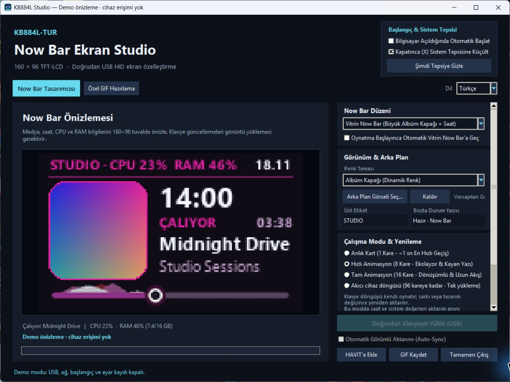
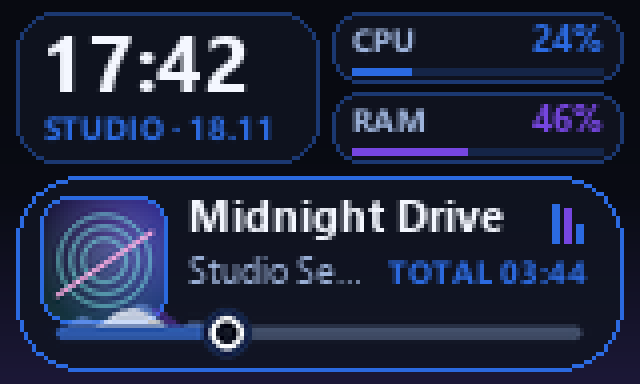
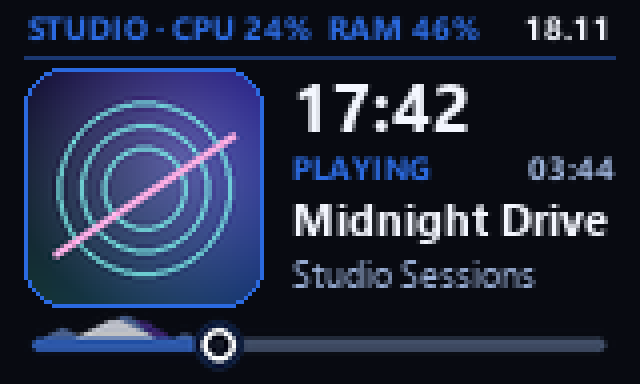
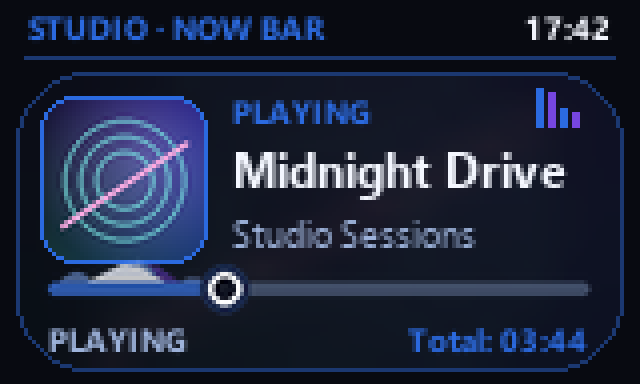
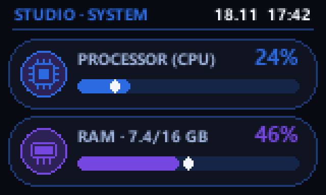

# KB884L Studio

[English](README.md) · [İndir](https://github.com/xCenny/kb884l-studio/releases/tag/v0.1.0)

HAVIT KB884L-TUR'un 160×96 ekranı için Windows tasarım ve USB aktarım uygulaması. Beş ekran düzeni, Windows medya bilgisi, GIF hazırlama, özel duvar kâğıdı, albüm renkleri ve Türkçe/İngilizce arayüz sunar.



> **Temel sınır:** Uygulama hâlâ tam görüntü/animasyon yükler. Veri değişiminde klavyenin uzun **Loading** ekranına girmesi çözülmedi. Bu bir özel firmware veya kesintisiz canlı ekran çözümü değildir.

## Kullanım

1. Releases sayfasındaki Windows x64 ZIP dosyasını indirip yazılabilir bir klasöre çıkar.
2. `KB884L-Studio.exe` dosyasını aç. Dil menüsünden Türkçe veya English seç.
3. Klavyeyi USB ile bağla; aktarım öncesi resmî HAVIT uygulamasını tamamen kapat.
4. Düzen, tema veya GIF seçip USB aktarım düğmesini kullan.

Temiz ilk açılışta otomatik aktarım ve Windows başlangıcı kapalıdır. Ayarlar `studio_settings.json` dosyasında saklanır. Kaynak veya sürüm paketine kişisel ayar ve duvar kâğıdı eklenmez.

## Ekranlar

| İkili Now Bar | Vitrin |
|---|---|
|  |  |

| Medya | Sistem |
|---|---|
|  |  |

Görseller uygulamanın ürettiği önizlemelerdir; fiziksel cihaz fotoğrafı değildir. Galeride örnek müzik bilgisi ve kodla üretilmiş kapak kullanılır.

## Bilinen sınırlar

- Doğrulanan cihaz KB884L-TUR, USB sürüm alanı `0x0111`, `SONiX / Gaming Keyboard`. Pro/HE ve diğer kart revizyonları desteklenmiş sayılmaz.
- Firmware değişmedi; hedef işlemci, firmware ve kurtarma yöntemi doğrulanmadı.
- Şarkı/durum değişimi yeniden aktarım gerektirir. Test cihazında 31 kare yaklaşık 32 saniye sürdü.
- Cihaz döngüsündeki saat, CPU/RAM ve medya çizimleri aktarım anının değerleridir. Hareketli göstergeler dekoratiftir; gerçek ses analizi değildir.
- Windows bildirimleri henüz ana akışa bağlı değildir. Linux/macOS desteği yoktur.
- Medya oturumu kapak sağlamazsa başlık ve sanatçı Apple iTunes Search API'ye gönderilerek kapak aranabilir. Spotify API anahtarı gerekmez.

## Kaynak ve derleme

Windows x64 ve Python 3.14 üzerinde:

```powershell
py -3.14 -m venv .venv
.\.venv\Scripts\python.exe -m pip install -r requirements.txt -r requirements-build.txt
.\.venv\Scripts\python.exe studio.py
.\.venv\Scripts\python.exe studio.py --demo
.\.venv\Scripts\python.exe scripts/build.py
```

`--demo` USB'ye, kişisel medyaya, ayarlara veya başlangıç kaydına dokunmadan örnek arayüzü açar. Derleme, testleri çalıştırır ve `dist/` içine EXE, ZIP ve sağlama toplamları üretir.

Tam özellikler, mod karşılaştırması, gizlilik ve araştırma durumu [İngilizce README](README.md) içindedir. Proje [MIT](LICENSE) lisanslıdır; HAVIT ile bağlantılı değildir.
